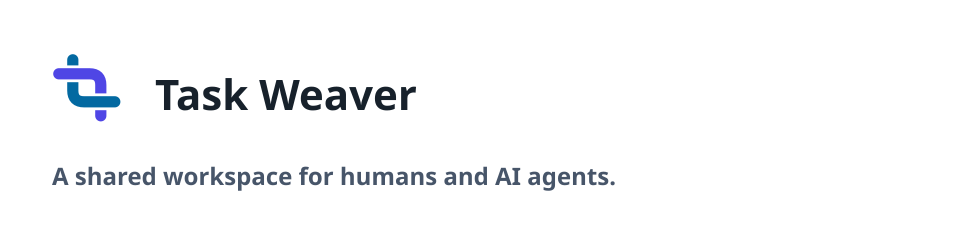
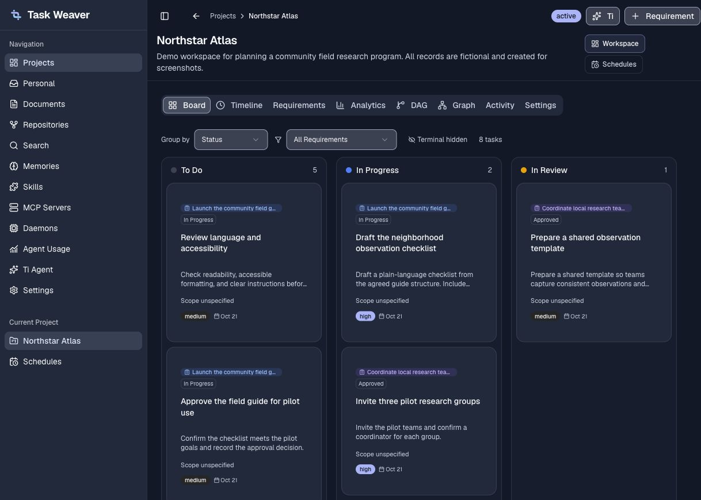
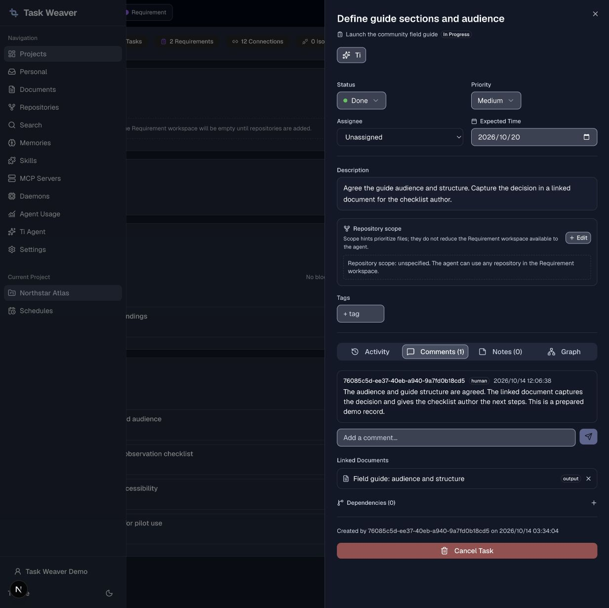

# Task Weaver

<picture>
  <source media="(prefers-color-scheme: dark)" srcset="design/brand/templates/readme-dark.svg">
  
</picture>

Task Weaver is a human–AI collaborative project management tool. Humans use the
Web UI; agents use the `tw` CLI, REST API, or GraphQL API. Both work with the same
projects, requirements, tasks, documents, and activity history.

The application includes kanban boards, a linked Markdown knowledge base,
keyword and vector search, agent task execution, and an MCP tool registry.

## What you can do

- Plan projects with requirements, tasks, dependencies, and kanban boards.
- Keep decisions and knowledge in linked Markdown documents with keyword and vector search.
- Collaborate with AI agents through the same tasks, activity history, CLI, and APIs.
- Discover external tools through the MCP registry and manage reusable agent skills.
- Control access with authenticated accounts, project memberships, and scoped credentials.

## See the workspace

Use the Board to follow tasks across requirements and spot work waiting for review.



<details>
<summary>See how a completed task hands context to the next task</summary>

A task keeps its discussion and linked output documents together. The next task
can reference the same document instead of rebuilding the context.



</details>

These screenshots show a local instance populated with fictional demo data.
Task states are prepared examples, not evidence of an agent executing live.

## Quick start

### 1. Run a local instance

You need Git, the Node.js version in `.node-version`, pnpm 9.15.0, and an empty
PostgreSQL database with **pgvector** available. The database user must be able to
run migrations and create the `vector` and `pg_trgm` extensions. If your database
provider restricts extension creation, ask its administrator to enable them first.

```bash
git clone https://github.com/limmytian/task-weaver.git
cd task-weaver
pnpm install --frozen-lockfile
cp .env.example .env
```

Edit your local `.env`. Set `DATABASE_URL` and uncomment the authentication
settings, replacing the secret placeholders. API and Web must use the same values:

| Setting | Local value |
| --- | --- |
| `DATABASE_URL` | Connection URL for your own empty PostgreSQL database |
| `TW_AUTH_SECRET` | A private random value of at least 32 characters |
| `TW_AUTH_BASE_URL` | `http://localhost:3001` |
| `TW_AUTH_TRUSTED_ORIGINS` | `http://localhost:3000` |
| `TW_AUTH_BOOTSTRAP_SECRET` | A separate private random value used for first setup |

Generate each secret separately with `openssl rand -hex 32`. Keep the populated
`.env` private and outside source control. Then initialize the database and start
the services:

```bash
pnpm exec dotenv -- pnpm --filter @task-weaver/db exec tsx src/migrate.ts
pnpm exec dotenv -- pnpm --filter @task-weaver/db db:setup-search
pnpm dev
```

Open [the local Web UI](http://localhost:3000/login). On a fresh instance, choose
first-administrator setup, enter your bootstrap secret, and create your account.
Remove `TW_AUTH_BOOTSTRAP_SECRET` from `.env` after setup and restart the services.
The [API health endpoint](http://localhost:3001/health) should report `ok`.

Use `localhost` consistently when running the Next.js development server. If you
change the browser hostname or port, update the exact trusted origin and follow
Next.js development-origin configuration as needed.

If startup fails at `CREATE EXTENSION vector`, install pgvector on the PostgreSQL
server; installing a Node.js package does not provide the database extension.
See [authenticated access](docs/authenticated-access.md) for account provisioning
and scoped credentials, and [authentication configuration](docs/authentication-contract.md)
for the full configuration contract. Use HTTPS outside loopback.

### 2. Create your first project

1. From **Projects**, choose **New Project** and give the project a goal.
2. Open the project and choose **Requirement**. Describe one outcome you want.
3. In **Requirements**, use **Add task** to break that outcome into concrete work.
   Every project task belongs to a requirement.
4. Use **Board** to follow progress, or **DAG** to inspect dependencies. A
   prerequisite points toward the work it unblocks.
5. Open a task to record discussion and review its linked documents. Keep useful
   decisions and outputs in **Documents** so later tasks can reuse them.

You can start with project planning and documents. Agent execution, Memories,
Skills, and MCP are optional capabilities to adopt when you need them.

### 3. Connect an agent when you need one

Create a scoped API Key in account settings for yourself or an Agent you own,
selecting the intended project and actions. An administrator account alone does
not give a Key access to every project. Run the [CLI instructions below](#cli),
then let `tw auth login` read the Key through its hidden prompt:

```bash
tw auth login --api-url http://localhost:3001
tw auth whoami --json
tw project list --json
```

Share the [Task Weaver skill](skills/task-weaver/SKILL.md) with your agent for the
data model, task claiming, and common workflows. For autonomous execution, follow
the [daemon pipeline guide](docs/daemon-pipeline-runbook.md).

### Container installation and upgrades

For containers, follow [installation and deployment](docs/deployment.md) and
select a matching, verified API/Web image pair from
[GitHub Releases](https://github.com/limmytian/task-weaver/releases).
The checked-in Compose defaults use older published images; follow the deployment
guide for their supported configuration. Source and published images may differ.
Back up data and read the [upgrade guide](docs/ce-upgrades.md) before upgrading.

## Development

The source checkout includes the Web UI, API, CLI, shared packages, migrations,
skills, and documentation. Development reads your local `.env`; the API imports
the bundled Task Weaver skill package at startup.

```bash
pnpm typecheck
pnpm lint
pnpm test
pnpm build
```

See [Contributing](CONTRIBUTING.md) for development and contribution guidelines.

## CLI

Run the CLI directly from the checkout:

```bash
pnpm --filter @task-weaver/cli exec tsx src/index.ts --help
pnpm --filter @task-weaver/cli exec tsx src/index.ts auth login
pnpm --filter @task-weaver/cli exec tsx src/index.ts project list --json
```

For regular use, add an alias pointing to the checkout's installed `tsx`:

```bash
alias tw='/path/to/task-weaver/node_modules/.bin/tsx /path/to/task-weaver/apps/cli/src/index.ts'
tw auth login
tw auth whoami --json
tw auth status
```

The CLI defaults to `http://localhost:3001`. `TW_API_URL` and `TW_API_KEY` may
override its saved configuration. Project tasks require a requirement; claim a
task before starting work and release the claim when finished. Add `--json` for
machine-readable output. npm package publication is not supported yet; use the
checkout instructions above.

## Documentation and community

- [Architecture](docs/design.md) ([简体中文](docs/design.zh-CN.md))
- [Authenticated accounts, CLI access and offline upgrade](docs/authenticated-access.md)
- [Deployment and rollback](docs/deployment.md)
- [Release history](docs/releases/README.md) and [release gates](docs/release-gates.md)
- [CE packages](docs/ce-packages.md) and [release operations](docs/release-operations.md)
- [Install, upgrade, and recovery](docs/ce-upgrades.md)
- [REST API reference](skills/task-weaver/rest-api-reference.md)
- [Agent workflows](skills/task-weaver/workflows.md)
- [Daemon pipeline runbook](docs/daemon-pipeline-runbook.md)
- [Contributing](CONTRIBUTING.md), [governance](GOVERNANCE.md), and [support](SUPPORT.md)
- [Security reporting](SECURITY.md) and [code of conduct](CODE_OF_CONDUCT.md)

## License

Copyright 2026 limmytian. Task Weaver is licensed under [Apache-2.0](LICENSE).
Third-party components retain their licenses; see [NOTICE](NOTICE),
[third-party notices](THIRD_PARTY_NOTICES.md), and `THIRD_PARTY_LICENSES/`.
Project branding is covered by the [trademark policy](TRADEMARKS.md).
